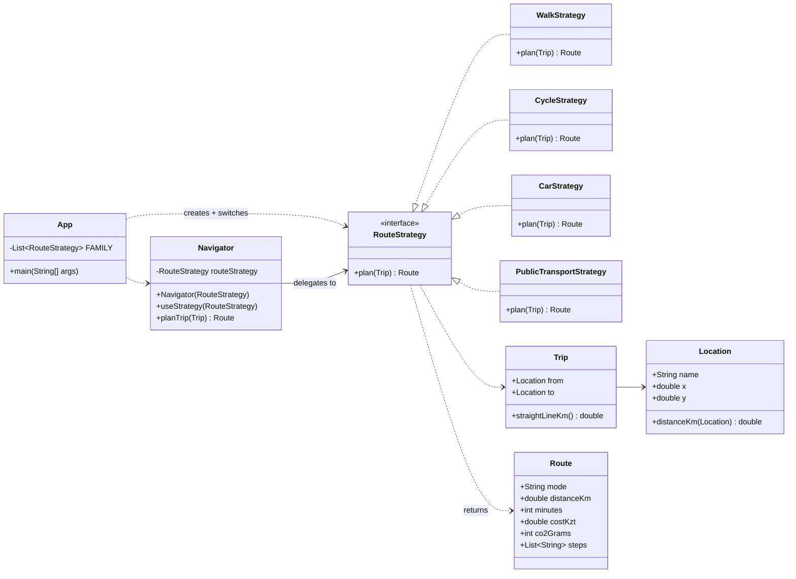

# Assignment #5 — Strategy Pattern

**Course:** ShP-2216 Software Design Patterns
**Topic:** Option A — Navigation / Route Planning
**Stack:** Java 17 · Maven · JUnit 5

A `Navigator` plans a route by delegating to one interchangeable `RouteStrategy` —
walking, cycling, driving or public transport. Each travel mode is a class that owns
its whole algorithm (path shape, speed, fares, emissions); the navigator knows none
of them and switches modes at runtime with a single method call.

---

## 1. Why this domain needs the pattern

"How do I get from A to B?" has several equally valid answers, and the right one
depends on the traveller, not on the route: the airport run is a car question, the
trip across the river is a bike question. Without the pattern, one class would have
to hold every algorithm and pick between them:

```java
// the version this project refuses to write
if (mode == WALK) {
    km = straight * 1.4; minutes = km / 4.8 * 60; cost = 0;
} else if (mode == CAR) {
    km = straight * 1.35; minutes = km / 30 * 60; cost = km * 18 + 500; ...
} else if (mode == BUS) { ... }
```

Every new mode edits that method, every rule of every mode lives in the same place,
and nothing can be tested or reused on its own. The Strategy pattern moves each
branch into its own class behind one interface, and the choosing out of the Context
entirely — the client decides, the navigator just delegates:

```java
navigator.useStrategy(new CycleStrategy());   // switch the algorithm, not a branch
Route route = navigator.planTrip(trip);       // one call, whichever strategy is in
```

## 2. The strategy family

| Strategy | The algorithm it owns |
|---|---|
| `WalkStrategy` | pavement paths (+40 % detour: crossings, footbridges), brisk 4.8 km/h pace, free, emission-free |
| `CycleStrategy` | bike lanes (+25 %), 15 km/h commuting pace, free, emission-free |
| `CarStrategy` | one-way streets and ring road (+35 %), 30 km/h city pace, fuel + parking, 150 g CO₂/km |
| `PublicTransportStrategy` | stops and transfer hub (+30 %), 18 km/h door to door, one fare per ~7 km boarding, 40 g CO₂/km |

`PublicTransportStrategy` was added **after** the first three strategies, the
navigator and their tests were finished — without changing a single existing class.
That commit is the open/closed principle made visible in the history.

## 3. Project structure

```
src/main/java/kz/aitu/sdp/navigation
├── App.java                 client: demo, owns every strategy choice
├── CityMap.java             the places of the demo on a simplified Astana grid
├── Navigator.java           Context: holds a strategy, delegates, switches at runtime
├── domain/                  Location, Trip, Route (immutable value records)
└── strategy/
    ├── RouteStrategy.java   the interface: one method, the whole contract
    ├── RouteMath.java       two shared package-private calculations
    ├── WalkStrategy.java
    ├── CycleStrategy.java
    ├── CarStrategy.java
    └── PublicTransportStrategy.java   added last, touched nothing existing

src/test/java/kz/aitu/sdp/navigation
├── NavigatorTest.java       delegation, runtime switching, algorithm-agnostic context
├── domain/RouteTest.java    immutability and validation of the value object
└── strategy/                one test class per strategy, known inputs, exact numbers
```

## 4. Build and run

```bash
mvn test        # 13 tests
mvn exec:java   # runs the demo
mvn package     # target/assignment5-strategy-pattern-1.0.0.jar, then: java -jar …
```

In IntelliJ IDEA: *File → Open* → pick the `pom.xml` (or the project folder) and run
`App`.

## 5. Demo output

`mvn exec:java`:

```
=== 1. Plan the airport trip with the default strategy (driving) ===
  mode                                       Driving
  distance                                   16.2 km
  time                                       32 min
  cost                                       792 KZT
  CO2                                        2430 g
    - Start the car at Astana IT University
    - Drive 16.2 km through the city streets
    - Park near Nursultan Nazarbayev Airport (parking fee included in the cost)

=== 2. Same navigator, same call - the strategy is switched at runtime ===
  after useStrategy(WalkStrategy)            Walking
  after useStrategy(CycleStrategy)           Cycling
  after useStrategy(PublicTransportStrategy) Public transport

=== 3. Compare the whole family on the same trip ===
  mode                 distance         time           cost        CO2
  Walking               16.8 km   3 h 30 min          0 KZT        0 g
  Cycling               15.0 km   1 h 00 min          0 KZT        0 g
  Driving               16.2 km       32 min        792 KZT     2430 g
  Public transport      15.6 km       52 min        630 KZT      624 g

=== 4. A short city trip - the client picks a different winner for a different question ===
  Walking                7.6 km   1 h 35 min          0 KZT        0 g
  Cycling                6.8 km       27 min          0 KZT        0 g
  Driving                7.3 km       15 min        631 KZT     1094 g
  Public transport       7.0 km       23 min        420 KZT      281 g

Demo finished.
```

## 6. How to add a new strategy

Nothing existing changes. Two steps:

1. **Write one new class** that implements the interface:

```java
public final class TaxiStrategy implements RouteStrategy {
    @Override
    public Route plan(Trip trip) {
        double km = trip.straightLineKm() * 1.2;          // taxis take the direct streets
        int minutes = RouteMath.minutesFor(km, 40.0);
        double cost = 700 + km * 110.0;                   // boarding + per-kilometre rate
        return new Route("Taxi", km, minutes, cost, 260, List.of(
                "Hail a taxi at " + trip.from().name(),
                "Ride " + RouteMath.km(km) + " km",
                "Get dropped off at " + trip.to().name()));
    }
}
```

2. **Register it in the client's list** — the one place that enumerates the family:

```java
private static final List<RouteStrategy> FAMILY = List.of(
        new WalkStrategy(), new CycleStrategy(), new CarStrategy(),
        new PublicTransportStrategy(),
        new TaxiStrategy());      // <-- the whole integration
```

That is the entire diff: one new file plus one line. `Navigator`, `RouteStrategy`,
the other strategies and all their tests are untouched — open for extension, closed
for modification. The same two steps were taken for `PublicTransportStrategy`
(commit *"feat: add the public transport strategy without touching existing classes"*).

## 7. UML



The Clean Code walkthrough with annotated excerpts, and the Strategy-vs-State
discussion, are in [REPORT.md](REPORT.md).

## 8. Design notes

* **The Context is algorithm-agnostic — provably.** `Navigator` mentions no concrete
  strategy; `NavigatorTest.knowsNothingAboutConcreteStrategies` scans its source and
  fails the build if a forbidden name or a branch ever appears there.
* **The interface is one method.** `plan(Trip)` is the entire contract; strategies
  share nothing but it (the two little shared calculations sit in package-private
  `RouteMath`, so no strategy depends on another strategy).
* **The client owns the choice.** The assignment forbids `if`/`switch` on strategy
  type *inside the Context*; here the Context holds no branch at all, and the family
  is listed exactly once, in `App`.
* **Routes are immutable values.** Every `Route` is a record with a defensive copy of
  its steps — a planned route cannot be edited behind the navigator's back.
* **Every number is a rule with a name.** `PAVEMENT_DETOUR`, `CITY_PACE_KMH`,
  `KM_PER_BOARDING` — the constants are the algorithm, documented once, tested exactly.
