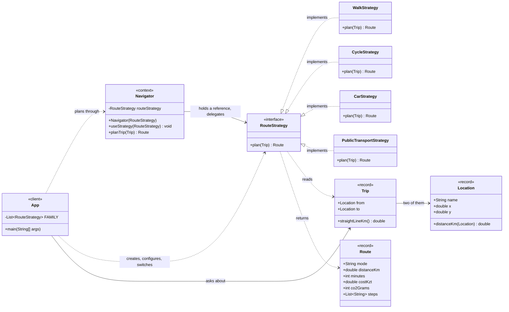

# Assignment #5 — Strategy Pattern: Navigation / Route Planning

| | |
|---|---|
| **Course** | ShP-2216 — Software Design Patterns |
| **Student** | Li Yixin, group SE-2526 |
| **Topic** | Option A — Navigation / Route Planning |
| **Language / tools** | Java 17, Maven, JUnit 5, IntelliJ IDEA |
| **Repository** | https://github.com/CCE-Li/AITU-SDP-Assignment5 |

---

## 1. Introduction

### 1.1 The chosen domain

The domain is city navigation. A traveller asks one question — *how do I get from
here to there?* — and the answer is a route: a distance, a duration, a cost, a CO₂
footprint and a short list of steps. The project models it on a simplified Astana
grid (`Astana IT University`, `Baiterek Tower`, `Khan Shatyr`, the railway station,
the airport), so every strategy computes real, checkable numbers instead of calling
an external maps API.

### 1.2 The algorithm family

"How to travel" is a family of interchangeable algorithms. All four answer the same
question over the same input (`Trip`) and return the same answer type (`Route`), but
each one encapsulates a genuinely different set of rules:

| Concrete strategy | The rules it owns |
|---|---|
| `WalkStrategy` | pavement paths are 40 % longer than the straight line (crossings, footbridges); brisk 4.8 km/h pace; free; zero emissions |
| `CycleStrategy` | bike lanes add only 25 % (no one-way loops); 15 km/h commuting pace; free; zero emissions |
| `CarStrategy` | one-way streets and the ring road add 35 %; 30 km/h city pace door to door; fuel ≈ 18 KZT/km plus a 500 KZT parking fee; 150 g CO₂/km |
| `PublicTransportStrategy` | stops and the transfer hub add 30 %; 18 km/h including waits; one 210 KZT fare per boarding, and roughly one boarding per 7 km of route; 40 g CO₂ per passenger-km |

### 1.3 Why this is a Strategy problem

The right algorithm is chosen **by the client, per request**, and the choice is
external to the calculation: the airport run with luggage is a driving or taxi
question; a trip to Khan Shatyr on a sunny day is a cycling question. No mode
"transitions" into another while planning. Interchangeable algorithms, selected at
runtime by the caller — exactly the situation the Strategy pattern exists for.

---

## 2. UML class diagram



Reading it: the **Client** (`App`) owns every choice — it builds the strategies,
hands them to the **Context** (`Navigator`) and switches them at runtime. The
**Strategy interface** (`RouteStrategy`) is one method; the four **concrete
strategies** hang off it and know nothing about each other. The Context holds one
`RouteStrategy` reference and never learns which implementation is behind it.

### 2.1 How a call flows

```
client:  navigator.useStrategy(new CycleStrategy())     // the client chooses
client:  Route r = navigator.planTrip(trip)             // same call every time
context:   return routeStrategy.plan(trip)              // pure delegation
strategy:    6.75 km, 27 min, 0 KZT, 0 g, steps…       // one algorithm, isolated
```

---

## 3. Clean Code principles

Six principles from Clean Code Ch. 10 and the Moodle reading are applied; each is
shown on real code from the project, with what the code would look like without it.

### 3.1 Conditional logic replaced by polymorphism

The pattern's core promise. Before, one method with a branch per mode — and every
new mode edits it (this is the version the project refuses to write):

```java
// BEFORE: the mode switch that used to select the algorithm
if (mode == WALK)      { km = straight * 1.4;  minutes = km / 4.8 * 60; cost = 0; }
else if (mode == CYCLE){ km = straight * 1.25; minutes = km / 15  * 60; cost = 0; }
else if (mode == CAR)  { km = straight * 1.35; minutes = km / 30  * 60; cost = km * 18 + 500; }
else if (mode == BUS)  { km = straight * 1.3;  minutes = km / 18  * 60; cost = 210 * 2; }
```

After, the branch is gone: each mode is a class, and selection is an object
reference the client sets.

```java
// AFTER: Navigator — the whole algorithm-choice machinery
public Route planTrip(Trip trip) {
    return routeStrategy.plan(trip);        // polymorphism picks the algorithm
}

public void useStrategy(RouteStrategy strategy) {
    this.routeStrategy = Objects.requireNonNull(strategy, "…");
}
```

### 3.2 Meaningful, intention-revealing names

The API reads as the sentence it performs — `planTrip`, `useStrategy`,
`straightLineKm`, `distanceKm`. The constants name the rule, not the number:

```java
private static final double PAVEMENT_DETOUR = 1.4;      // crossings, footbridges
private static final double KM_PER_BOARDING = 7.0;      // one transfer per 7 km
private static final double FUEL_KZT_PER_KM = 18.0;     // 7.3 l/100 km at 245 KZT/l
```

**Without it** — `p.calc(t, 2)`, `STRAT_B`, `double d = t.dist() * K1;`: every
reader must reverse-engineer which magic number belongs to which mode.

### 3.3 Single Responsibility: one strategy, one algorithm

Each strategy class contains its algorithm and nothing else — no mode it is not, no
UI, no choice logic. The whole public surface of a strategy is one method:

```java
public final class WalkStrategy implements RouteStrategy {
    @Override
    public Route plan(Trip trip) { … }     // walking, and that is all
}
```

The benefit is visible in the sizes: `WalkStrategy` 31 lines, `CycleStrategy` 31,
`CarStrategy` 38, `PublicTransportStrategy` 49 — the Javadoc included. Each is
testable in isolation with known inputs (`WalkStrategyTest` feeds a 3-4-5 triangle
and expects exactly 7.0 km and 88 minutes), because no other mode's code can
interfere. **Without it**, the four algorithms share one method and one test
fixture, and a change to the fare rule risks the walking pace.

### 3.4 The Context stays algorithm-agnostic

`Navigator` knows the interface and nothing behind it — no concrete strategy name,
no `instanceof`, no branch on a strategy. This is not just stated, it is enforced by
a test that reads the Context's own source:

```java
// NavigatorTest.knowsNothingAboutConcreteStrategies
String codeOnly = Files.readString(source)
        .replaceAll("(?s)/\\*.*?\\*/", "")    // strip Javadoc
        .replaceAll("//[^\n]*", "");          // strip line comments

List<String> forbidden = List.of(
        "WalkStrategy", "CycleStrategy", "CarStrategy", "PublicTransportStrategy",
        "instanceof", "switch", "if (", "if(");

for (String token : forbidden)
    assertTrue(!codeOnly.contains(token), "Navigator must not contain '" + token + "'");
```

**Without it** the Context slowly grows a "special case": `if (strategy instanceof
CarStrategy) addTolls();` — and the pattern dies one convenience at a time. Here the
build fails on the first attempt.

### 3.5 Extensibility: open for extension, closed for modification

`PublicTransportStrategy` was added **after** the interface, the Context, the first
three strategies and their tests were complete and green. The whole change was one
new class — plus one line registering it in the client's family list:

```java
private static final List<RouteStrategy> FAMILY = List.of(
        new WalkStrategy(),
        new CycleStrategy(),
        new CarStrategy(),
        new PublicTransportStrategy());   // the new mode joins by existing, not by editing
```

`Navigator`, `RouteStrategy`, the three existing strategies and all their tests were
not touched. The commit history shows it as a separate commit, and the new class
came with its own test on day one (`PublicTransportStrategyTest`) because the
interface contract made it testable immediately. **Without it** the same addition
would mean editing the branched method of §3.1, re-testing every mode, and risking
each of them.

### 3.6 Immutability and defensive copies

Domain values are records, and the one mutable-shaped field is copied on the way in:

```java
public record Route(String mode, double distanceKm, int minutes, double costKzt,
                    int co2Grams, List<String> steps) {
    public Route {
        if (distanceKm < 0 || minutes < 0 || costKzt < 0 || co2Grams < 0)
            throw new IllegalArgumentException("A route cannot have negative numbers");
        steps = List.copyOf(steps);        // defensive copy + read-only
    }
}
```

A planned `Route` cannot be edited behind the navigator's back — the caller's list
and the route's steps are separate objects (`RouteTest.keepsItsStepsImmutable`
proves both directions). **Without it**, a caller mutating the returned steps (or
the array the strategy passed in) would silently rewrite a route the client may
already have shown or compared.

---

## 4. Strategy vs. State

Strategy and State share a mechanical trick — a Context that delegates to a
polymorphic helper object — and differ in *who changes the helper and why*. In
**State**, the Context's behaviour depends on an internal state that the object
itself moves between: state objects typically trigger transitions to each other
(`Draft → Submitted → Approved`), the Context does not choose, and the states form a
lifecycle. In **Strategy**, the helper is one of several *interchangeable
algorithms*; an outside **client** picks and swaps it at runtime, and the strategies
are mutually unaware — there are no transitions at all. This project is clearly the
second case: the traveller, not the navigator, decides that the airport run is a
`CarStrategy` question and the Khan Shatyr trip a `CycleStrategy` question;
`WalkStrategy` never hands over to `BusStrategy` mid-route. If instead the navigator
were to change its own behaviour automatically in response to events (traffic ahead
→ switch to transit, rain → forbid cycling), the modes would form a lifecycle and
the same delegation would be the State pattern. The one-line test used in the
defense: *does the context's helper change because the client chose differently
(Strategy), or because the object's own situation changed (State)?*

---

## 5. Conclusion

**Flexibility gained.** A new travel mode is one new class plus one line in the
client's list — demonstrated, not claimed, by `PublicTransportStrategy`, which
joined a finished, tested system without modifying any existing file. Modes can be
compared, chosen per trip and swapped at runtime through one call; every algorithm
is a 30–50-line class that can be understood, tested and reused alone; and the
Context's algorithm-agnostic nature is pinned by a test that reads its source.

**Classes added.** The honest cost: one interface, four strategy classes and a
shared `RouteMath` instead of a single `if/else` chain — six more files than the
branched version, plus one test class per strategy. The indirection also means a
reader must open a second file to see what "planning a trip" does.

**The trade.** The branched version is cheaper only while there is exactly one
method that chooses modes and exactly one developer who edits it. The moment
algorithms vary independently — ours differ in path shape, speed, fare *and*
emissions — the single method becomes the file every change touches and every bug
lands in. Six small closed classes beat one open method precisely when the family
grows; a navigation app that will never add a fifth mode could live without the
pattern, but nothing in the requirements suggests that.

---

## 6. Repository

https://github.com/CCE-Li/AITU-SDP-Assignment5

* `mvn test` — 13 tests, all green.
* `mvn exec:java` — the live demo: default strategy, three runtime switches, the
  family comparison on two trips (README §5).
* Incremental commits: scaffold → domain → interface + Context → three strategies →
  client demo → the public transport strategy added without touching existing
  classes → tests → docs.

---

## References

* Freeman, E., & Robson, E. (2021). *Head First Design Patterns* (2nd ed.), Ch. 1 — the Strategy pattern. O'Reilly.
* Martin, R. C. (2008). *Clean Code*, Ch. 10 — classes. Prentice Hall.
* Lecture 7 slides, ShP-2216 (Moodle LMS) — Strategy components and the comparison with State.
* refactoring.guru — Strategy pattern: https://refactoring.guru/design-patterns/strategy
